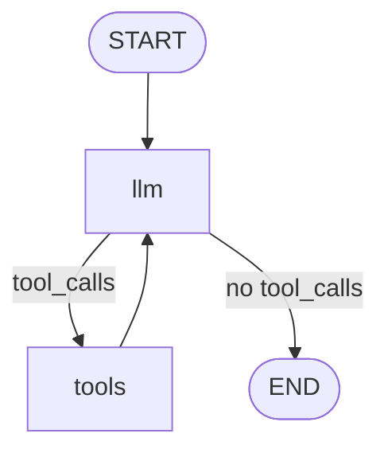

# Expense Helper Agent

A stateful conversational agent built with **LangGraph** and **Google Gemini** (`gemini-3.5-flash-lite`), featuring tool calling (`calculator`, `web_search`, `eur_to_usd`) and per-thread in-memory conversation history (`MemorySaver`).

## Architecture



- **`agent.py`**: Defines the LangGraph state, tools (`calculator`, `web_search`, `eur_to_usd`), `build_graph()`, and a CLI REPL.
- **`streamlit_app.py`**: Web chat UI with `st.session_state` persistence, sidebar `thread_id` switcher, Mermaid graph view, and collapsible tool-call logs.
- **`test_agent.py`**: Live verification suite against Gemini.

## Setup

```bash
python3 -m venv .venv
.venv/bin/pip install -r requirements.txt
```

Create a `.env` file in the project root with your Gemini API key:

```env
GEMINI_API_KEY="your-api-key"
```

## Running

### CLI

```bash
.venv/bin/python agent.py
```

Optional flags: `--model gemini-3.5-flash-lite`, `--thread <thread_id>`.

### Streamlit UI

```bash
.venv/bin/streamlit run streamlit_app.py
```
